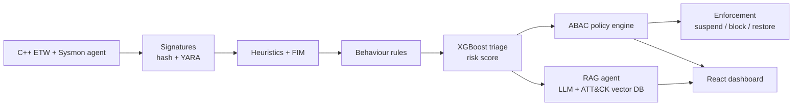

# ThreatPulse

**Behaviour-based, AI-assisted endpoint threat detection for Windows: a 4th-generation malware scanner.**

> **Status:** Active development. See [PLANNING.md](PLANNING.md) for the full plan, [PHASES.md](PHASES.md) for step-by-step phases, and [ROADMAP.md](ROADMAP.md) for who builds what.

---

## Problem statement

Traditional antivirus relies mainly on **static analysis**: it checks a file's hash or byte patterns against a list of known-bad samples. That approach has three well-known weaknesses:

1. **Easy to evade.** Packing, obfuscation, recompiling and dynamic API resolution change what a file *looks like* without changing what it *does*, so signatures stop matching.
2. **False positives.** Legitimate software is also packed or compressed, so purely static heuristics flag harmless programs.
3. **Alerts without explanation.** Even when a tool raises an alert, an analyst still has to work out *what happened* and *which attack technique* it was, which is slow and needs expertise.

**ThreatPulse asks:** can we detect threats by watching what programs *do* at runtime, contain the dangerous ones automatically without risking harmful mistakes, and explain each incident in plain language mapped to a recognised framework (MITRE ATT&CK)?

## Our approach

ThreatPulse watches runtime behaviour on a Windows endpoint and passes it through a layered pipeline:

1. **Sense:** a C++ agent collects process, file, registry and network activity using **Event Tracing for Windows (ETW)** and **Sysmon**.
2. **Detect:** events pass through signature checks, static heuristics, file integrity monitoring and ATT&CK-mapped behaviour rules.
3. **Score:** a fast **XGBoost** model gives each suspicious process a risk score, so only the small number of high-risk cases go further.
4. **Enforce:** a deterministic **attribute-based access control (ABAC)** policy engine protects critical system areas and takes limited containment actions (suspend, block network, restore).
5. **Explain:** an **LLM with retrieval-augmented generation (RAG)** over MITRE ATT&CK writes a human-readable incident report. The LLM *explains only*: it never takes action.
6. **Show:** a **React dashboard** displays telemetry, risk scores, decisions and reports, and asks an analyst to approve destructive actions.

## Why "4th generation"?

Anti-malware design is commonly described in four generations: simple signature scanners, heuristic scanners, activity traps, and full-featured protection that adds access control (Stallings & Brown, *Computer Security: Principles and Practice*). ThreatPulse implements **every generation** and extends the fourth with **AI/ML analysis**:

| Generation | Technique | ThreatPulse component |
|---|---|---|
| 1st | Signatures | SHA-256 known-bad hash list, YARA rules |
| 2nd | Heuristics + integrity checking | Static PE heuristics (entropy, packers, imports; EMBER-trained model), File Integrity Monitoring of critical files and registry keys |
| 3rd | Behaviour (activity traps) | ETW/Sysmon telemetry + Sigma-style behaviour rules mapped to ATT&CK |
| 4th | AI / ML | XGBoost behavioural triage + LLM/RAG incident reports |
| 4th | Access control enforcement | ABAC policy engine guarding protected zones |

## Architecture



## Protected zones

| Zone | Threat | Response |
|---|---|---|
| User document folders | Ransomware | Windows Controlled Folder Access + our own mass-encryption detector → suspend |
| Run/RunOnce keys, startup folders, hosts file | Persistence | Detect change → restore unapproved changes from baseline → suspend high-risk origin process |
| LSASS process memory | Credential dumping | Detect memory-read access (Sysmon Event ID 10) by a non-allowlisted process → suspend. With LSA protection on no access is recorded, so the dump command line is what is detected (PLANNING.md 4.3) |
| Network | Exfiltration / C2 | Per-program Windows Firewall block rule |

## Design principles

1. **The LLM never triggers enforcement.** It reads attacker-controlled text (command lines, file names), so it is exposed to indirect prompt injection. Only the deterministic policy engine acts.
2. **The LLM has no tools.** No internet access, no commands, no process control: it only returns text. Telemetry is wrapped in delimiters and treated as data, never as instructions.
3. **Humans approve destructive actions.** Automatic actions are limited to *suspend*, *block network* and *restore from baseline*. Killing processes or deleting files needs analyst approval.
4. **The LLM is only called after triage.** Raw events never go to the LLM.
5. **Reports are grounded.** Every ATT&CK technique ID in a report is checked against the official ATT&CK dataset.

## Tech stack

| Part | Technology |
|---|---|
| Endpoint agent | C++, Windows ETW (via Microsoft's `krabsetw`), Sysmon |
| Signatures & heuristics | YARA, `pefile`, EMBER features |
| Triage | Python, XGBoost |
| Backend | FastAPI |
| RAG agent | LangChain, ChromaDB, MITRE ATT&CK STIX data |
| Dashboard | React |
| Testing | Atomic Red Team, EICAR test file, harmless custom simulation scripts |

## Repository structure (planned)

```
agent/        C++ endpoint agent (ETW + Sysmon collection, FIM)
detection/    Signature, heuristic and behaviour-rule layers
triage/       Feature extraction, XGBoost training, model files
policy/       ABAC policy engine and enforcement actions
backend/      FastAPI service, pipeline orchestration, RAG agent
frontend/     React dashboard
rules/        YARA rules, behaviour rules, policy rules (YAML)
contracts/    JSON schemas and sample data shared between components
data/         ATT&CK data, hash lists, simulated logs (no live malware)
docs/         Architecture, setup guides, evaluation reports
```

## Safety and ethics

- **No live malware.** All testing uses Atomic Red Team, the EICAR test file and our own harmless simulation scripts.
- **Isolated lab only.** The agent, simulations and all enforcement actions run inside a disposable Windows virtual machine with snapshots, never on a developer workstation. Enforcement code refuses to run unless it detects the lab VM.
- ThreatPulse is a **prototype for controlled lab environments**, not a production security product.

## Team

| Name | Role |
|---|---|
| Ahmed Mubeen | Repository lead. Sense & Enforce: endpoint agent, integrity monitoring, policy engine, enforcement, lab environment |
| Haider Shahid | Detect & Score / Explain & Show |
| Ahmed Muaz | Detect & Score / Explain & Show |

## Key references

- Anderson, H. S., & Roth, P. (2018). *EMBER: An Open Dataset for Training Static PE Malware Machine Learning Models.* arXiv:1804.04637.
- Arp, D., et al. (2022). *Dos and Don'ts of Machine Learning in Computer Security.* USENIX Security Symposium.
- Chen, T., & Guestrin, C. (2016). *XGBoost: A Scalable Tree Boosting System.* ACM KDD.
- Greshake, K., et al. (2023). *Not What You've Signed Up For: Compromising Real-World LLM-Integrated Applications with Indirect Prompt Injection.* ACM AISec.
- Hu, V. C., et al. (2014). *Guide to Attribute Based Access Control (ABAC) Definition and Considerations.* NIST SP 800-162.
- Lewis, P., et al. (2020). *Retrieval-Augmented Generation for Knowledge-Intensive NLP Tasks.* NeurIPS.
- Stallings, W., & Brown, L. *Computer Security: Principles and Practice.* Pearson.
- Strom, B. E., et al. (2018). *MITRE ATT&CK: Design and Philosophy.* MITRE Technical Report.

The full reference list is in [PLANNING.md](PLANNING.md#11-references).
